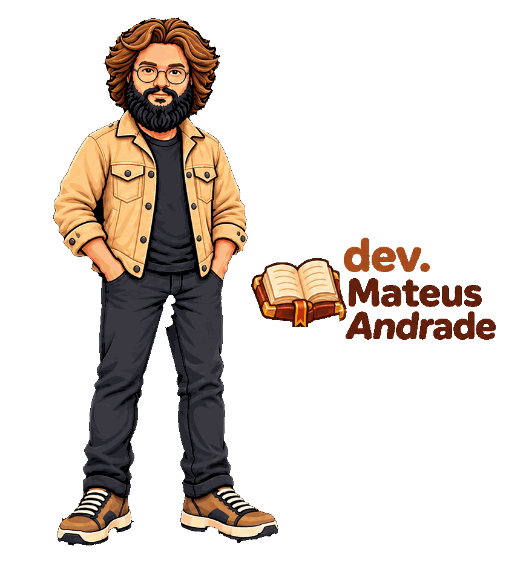

## 👩🏻‍💻 Matheus da Silva Andrade

**`Desenvolvedor FullStack`**

Me chamo **Matheus Andrade**, tenho 23 anos e sou natural de Franca/SP. Sou Técnico em Informática pela ETEC Dr. Júlio Cardoso (Centro Paula Souza), concluinte de Licenciatura em Filosofia pela Universidade Pitágoras Unopar Anhanguera e graduando do terceiro ano em História (Licenciatura/Bacharelado) pela UNESP e Pedagogia (Licenciatura) pela Universidade Pitágoras Unopar Anhanguera. Desenvolvo projetos **Front-end, Back-end e Full Stack**, utilizando HTML, CSS, JavaScript, Python, PHP, jQuery, PostgreSQL, Linux, Git, GitHub, Docker e APIs REST. Entre meus projetos destacam-se o **Ameríndia**, desenvolvido como Iniciação Científica voluntária (PIBIC), e o **Voz do Professor**, voltado à minha futura pesquisa de mestrado. Utilizo este perfil para modular, documentar e versionar meus projetos, integrando tecnologia, educação e pesquisa acadêmica, além de estar aberto a oportunidades freelancer.

    
    
  <a href="http://lattes.cnpq.br/2995910024222315">
        
    

---

<!-- Portfólio em destaque: primeira coisa depois da apresentação -->
<h2 align="center">📖 Meu portfólio é um livro — abra e folheie</h2>

  <b>Em vez de uma página comum, um livro 3D interativo sobre quem eu sou e o que eu construo.</b> 
  Abra a capa, vire as páginas e conheça minha trajetória, minhas tecnologias e meus projetos — com trilha sonora, objetos na mesa e versões em português e inglês.

  

  

---

### 🤖 Linguagens e Tecnologias

 
 

### 📊 Estatísticas

  

  
  

Dados públicos de <a href="https://github.com/anddrad3">anddrad3</a>, atualizados automaticamente duas vezes por dia. Cards: <a href="https://ghstats.dev">GHStats</a> e <a href="https://github.com/Pranesh-2005/github-readme-stats-fast">GitHub Readme Stats Fast</a>. As linguagens representam o código dos repositórios, não o nível de domínio de cada tecnologia.

###

  

###

<h2 align="center">🤖 Meus Projetos</h2>

  

<!-- Estante de projetos: 3 por linha. Para um novo projeto, abra um novo <tr> com até 3 células (a última linha é o espaço "em breve"). -->
<table align="center">
  <tr>
    <td align="center" valign="bottom" width="250">
      <a href="https://amerindia.alwaysdata.net/voz-do-professor/" target="_blank"> 
      </a> 
      <a href="https://amerindia.alwaysdata.net/voz-do-professor/" target="_blank"><b>Voz do Professor</b></a> 
      Pesquisa de mestrado
    </td>
    <td align="center" valign="bottom" width="250">
      <a href="https://matityahu.alwaysdata.net/" target="_blank"> 
      </a> 
      <a href="https://matityahu.alwaysdata.net/" target="_blank"><b>MLG</b></a> 
      Organização pessoal e financeira
    </td>
    <td align="center" valign="bottom" width="250">
      <a href="https://amerindia.alwaysdata.net/" target="_blank"> 
      </a> 
      <a href="https://amerindia.alwaysdata.net/" target="_blank"><b>Ameríndia</b></a> 
      Iniciação Científica · PIBIC
    </td>
  </tr>
  <tr>
    <td align="center" valign="bottom" width="250">
      <a href="https://github.com/anddrad3/BloqueiaShorts" target="_blank"> 
      </a> 
      <a href="https://github.com/anddrad3/BloqueiaShorts" target="_blank"><b>Bloqueia Shorts</b></a> 
      App Android contra os Shorts do YouTube
    </td>
      <td align="center" valign="bottom" width="250">
      <a href="https://i.pinimg.com/originals/57/fe/18/57fe18529703399df7926d81eed67ff6.jpg?nii=t" target="_blank"> 
      </a> 
      <a href="https://github.com/anddrad3/BloqueiaShorts" target="_blank"><b>Livrário</b></a> 
      Controle de acervo literário pessoal
    </td>
    <td colspan="2" align="center" valign="bottom">
       
      
    </td>
  </tr>
</table>

###

## 👾 Meus Commits

<picture data-importer="pacman">
  <source media="(prefers-color-scheme: dark)" srcset="https://raw.githubusercontent.com/anddrad3/anddrad3/pacman-output/pacman-contribution-graph-dark.svg?game=pacman">
  <source media="(prefers-color-scheme: light)" srcset="https://raw.githubusercontent.com/anddrad3/anddrad3/pacman-output/pacman-contribution-graph.svg?game=pacman">
  
</picture>

###
